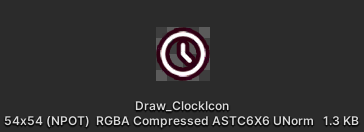
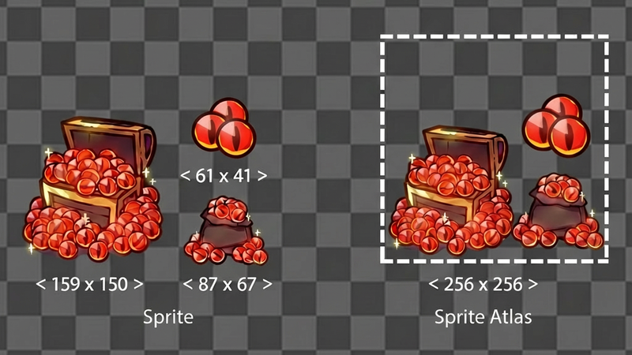
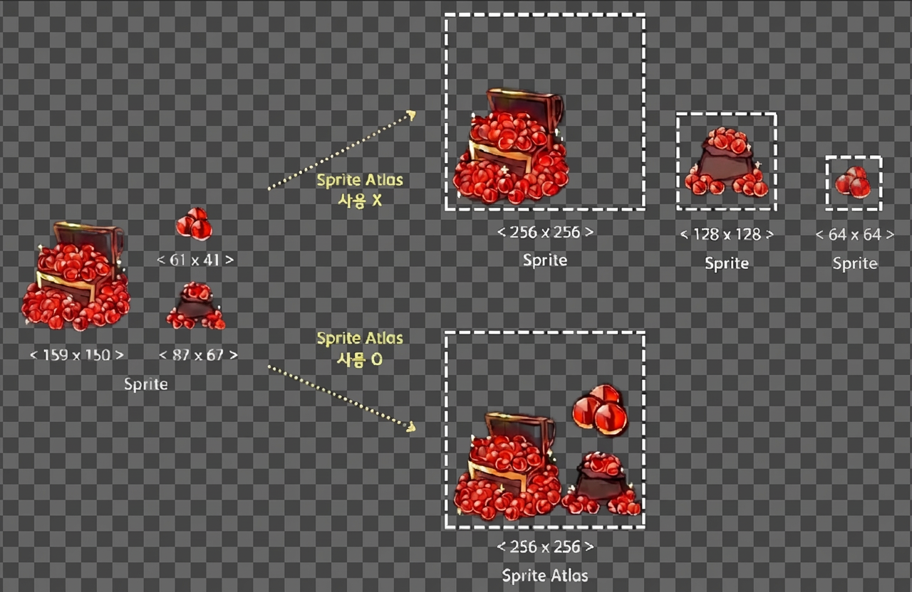
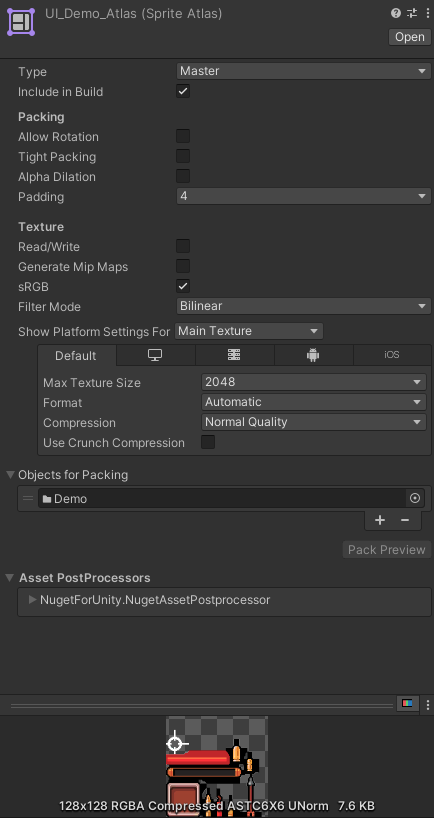
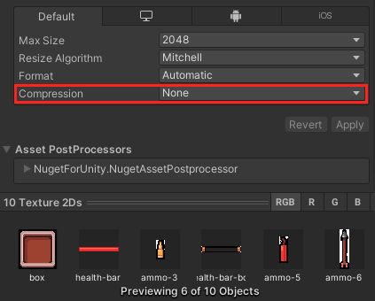
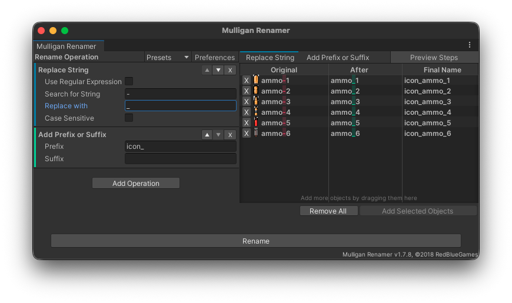

+++
title = "Unity Sprite Atlas 이해와 리소스 구성"
date = 2026-09-28T19:18:00+09:00
tags = ["unity", "sprite-atlas", "optimization", "resource-management"]
categories = ["Unity"]
summary = "Sprite Atlas의 패킹 원리와 성능상 주의점을 살펴보고, 화면과 로딩 단위를 기준으로 UI 리소스의 폴더 구조와 관리 규칙을 정리한다."
+++

## Sprite Atlas 이해하기

### 개요

게임 빌드에서 가장 큰 용량 비중을 차지하는 요소는 텍스처입니다.
텍스처 용량이 증가하면 빌드 크기뿐만 아니라 런타임 메모리 사용량과 로딩 성능에도 직접적인 영향을 미칩니다.
이를 효율적으로 관리하기 위해 Unity는 여러 스프라이트를 하나의 텍스처로 묶어 최적화할 수 있는 SpriteAtlas 기능을 제공합니다.

### Sprite Atlas란

Sprite Atlas 란 여러 개의 텍스처(Sprite)를 하나의 큰 POT (Power Of Two) 텍스처로 묶는 에셋을 뜻합니다.

그럼 POT (Power Of Two) 는 무엇일까요? 쉽게 말해서 2의 거듭제곱을 의미합니다.

```text
2¹ = 2
2² = 4
2³ = 8
2⁴ = 16
2⁵ = 32
2⁶ = 64
2⁷ = 128
2⁸ = 256
2⁹ = 512
2¹⁰ = 1024
```

**POT 사이즈가 중요한 이유**

유니티는 이 GPU에게 아틀라스를 건내주면서 이것을 인식하여 화면에 그려달라는 요청을 보냅니다.

- GPU는 POT 텍스쳐를 가장 효율적으로 읽음

- POT가 아니면:
  - GPU가 내부적으로 POT로 변환 후 처리
  - → 성능 손실 + 불필요한 연산 발생



> [!WARNING]
> NPOT : 해당 텍스쳐는 POT 가 아니라는 의미. 아틀라스를 사용하는 경우에는 필히 POT 와 비압축상태로 설정.

### Sprite Atlas의 패킹 원리



위처럼 여러 개의 작은 스프라이트를 “가장 낭비 없이” 하나의 큰 텍스처(POT 크기)에 테트리스처럼 배치하는 과정입니다.

패킹 알고리즘에 의해 Atlas 크기 결정되는데

Unity는 먼저:

“이걸 다 넣으려면 최소 몇 픽셀짜리 텍스처가 필요하지?”

그래서:

- 가장 가까운 POT 크기를 선택함
- 여기선 → 256 × 256

이게 오른쪽 점선 박스입니다.

### Sprite Atlas를 사용하는 이유



**메모리 최적화**

GPU는 텍스처를 2의 제곱(Power of Two) 크기로 처리하므로, 작은 이미지 여러 개를 하나로 묶으면 낭비되는 메모리를 줄일 수 있습니다.

**Draw Call 감소**

개별 스프라이트마다 렌더링 요청을 보내는 대신, Atlas 하나로 묶으면 한 번의 Draw Call로 처리 가능하며 성능 향상에 효과적입니다.

> [!IMPORTANT]
> 항상 아틀라스를 사용하는 것이 정답은 아닙니다. 배경 텍스쳐같은 경우에는 사이즈가 크기 때문에 아틀라스로 묶는 것보다는
> 원본 텍스쳐 그대로 사용하는 것이 더 나을 수 있습니다.
>
> 이유는 한 화면에서 여러 배경을 동시에 렌더링하진 않기 때문입니다.

Sprite Atlas는 메모리 절약 + Draw Call 감소에 효과적이지만, 동시에 화면에 등장하는 리소스끼리 묶는 것이 중요하며
모든 상황에서 해법이 되지 않으니 POT 를 이해하고 사용해야 합니다.

그렇다면 실제 프로젝트에서는 어떤 리소스를 함께 묶고, 어떻게 관리하면 좋을까요? 앞서 살펴본 내용을 바탕으로 폴더 구조와 네이밍, 아틀라스 분리 기준을 살펴보겠습니다.

## 리소스 구성 가이드

아래에서는 Sprite Atlas 리소스를 구성할 때 참고할 핵심 원칙을 정리합니다. 세부 설정은 [Unity 공식 문서](https://docs.unity3d.com/kr/2022.3/Manual/sprite-atlas.html)를 참고하시기 바랍니다.

### SpriteAtlas 생성 및 설정

1. SpriteAtlas 생성
2. 스프라이트 추가
3. 기본 옵션 설정



> [!TIP]
> 기본 권장 옵션입니다. 공식 문서를 읽어보시고 필요에 따라 커스텀 설정하시면 됩니다.

### 스프라이트 폴더 구조

권장 구조는 **원본(Sprites)과 Atlas(에셋)를 분리**하고, Atlas와 1:1로 매칭되게 구성하는 것입니다.

```text
Assets/
 └─ UI/
     ├─ Sprites/
     │   ├─ Common/
     │   ├─ Lobby/
     │   └─ HUD/
     │
     └─ Atlases/
         ├─ UI_Common.spriteatlas
         ├─ UI_Lobby.spriteatlas
         └─ UI_HUD.spriteatlas
```

- `Sprites/`: 원본 PNG 관리
- `Atlases/`: SpriteAtlas 에셋만 관리

> [!TIP]
> 이 구조를 사용하면 **어떤 스프라이트가 어떤 Atlas에 포함되는지 직관적으로 추적**할 수 있습니다.



> [!TIP]
> 원본 스프라이트는 비압축 상태로 유지하는 것이 품질과 관리 측면에서 안정적입니다.

### 네이밍 규칙

본 가이드는 권장 규칙을 제시하는 것이므로, 각 프로젝트의 특성과 운영 환경에 맞게 유연하게 적용하시기 바랍니다.

#### Atlas 이름 규칙

```text
UI_{Category}_Atlas
UI_{Screen}_Atlas
```

예:

- UI_Common_Atlas
- UI_Lobby_Atlas
- UI_BattleHUD_Atlas

#### Sprite 이름 규칙

```text
{type}_{name}_{state}
```

예:

- btn_play_normal
- btn_play_pressed
- icon_gold
- icon_gold_small
- bg_lobby_main
- bg_popup_dark



> [!TIP]
> 유니티용 [Mulligan Renamer](https://github.com/redbluegames/unity-mulligan-renamer) 도구를 사용하면 여러 에셋이나 게임 오브젝트의 이름을 한 번에 빠르고 안전하게 변경할 수 있습니다.

### Atlas 분리 전략

SpriteAtlas는 **기능 단위와 로딩 단위 기준으로 분리**하는 것이 성능과 유지보수 측면에서 유리합니다.

#### 권장 분리 기준

- **UI 화면 단위**
  - `UI_Lobby_Atlas`
  - `UI_Shop_Atlas`
  - `UI_Inventory_Atlas`
- **기능 단위**
  - `UI_Common_Atlas`
  - `UI_Popup_Atlas`
  - `UI_Icons_Atlas`

#### 운영 원칙

- 항상 로드되는 UI는 `UI_Common_Atlas`으로 분리
- 특정 화면에서만 쓰는 리소스는 전용 Atlas로 분리
- 너무 큰 Atlas는 **메모리 사용량 증가 및 패킹 비효율**을 유발하므로 분할 권장
- 애니메이션용 스프라이트는 별도 Atlas로 관리

### 중복 리소스 관리

중복 스프라이트는 **메모리 낭비, 빌드 용량 증가, 관리 복잡도 상승**의 주요 원인입니다.

**관리 전략**

- 공용 리소스는 반드시 `UI_Common_Atlas` 또는 `Sprites/Common` 경로에만 배치
- 동일한 이미지가 여러 폴더에 존재하지 않도록 정기 점검
- SpriteAtlas 기반 Sprite Picker를 사용해 **어떤 스프라이트가 어떤 Atlas에 포함되어 있는지 시각적으로 확인**
- 네이밍 기준이 같은 파일이 여러 개 발견되면 **단일 리소스로 통합**

**권장 워크플로우**

1. 신규 스프라이트 추가 시 기존 Atlas 검색
2. 유사 이미지 존재 여부 확인
3. 공용 가능 리소스는 Common Atlas로 이동
4. 화면 전용 리소스만 전용 Atlas에 유지

이 방식을 유지하면 **중복 리소스 검출이 쉬워지고, 메모리와 빌드 용량을 안정적으로 관리할 수 있습니다.**
